# Staff Sharp

A practice and interview-prep tool that keeps staff+ engineers sharp. It has 430+ hand-written questions across 12 domains,
regiments from a one-question drill to a 30-day plan, model grading for open answers, and a profile that shows where your
edge has dulled.

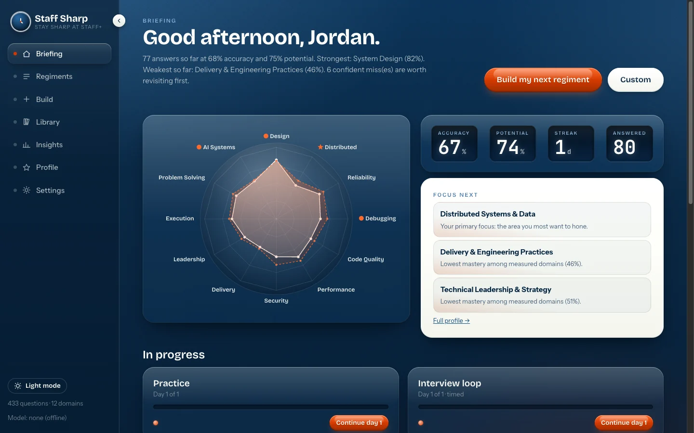

```bash
cp .env.example .env                          # optional: every value has a working default
ANTHROPIC_API_KEY= docker compose up -d --build
open http://localhost:8484
```

The empty `ANTHROPIC_API_KEY=` keeps your shell's key out of the containers. Pick a model provider later, in Settings.

> The screenshots use seeded demo data, and they show the bundled fallback fonts. The design's licensed fonts aren't in the
> repo; see [Fonts](#fonts).

## Tour

### Onboarding and calibration

The first visit runs a short survey: name, years of experience, primary language, focal points, primary focus and staff
archetype. A 15-minute calibration quiz follows: one closed question per domain, three at each level from strong senior to
principal. It estimates your starting level with a small item-response model and seeds your star plot.

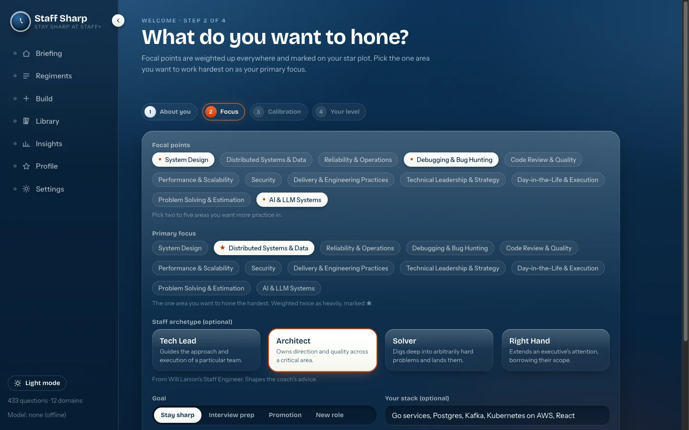

### Build a regiment

Set the days, questions per day, level range, domains, question types, a timer, feedback timing, adaptive weighting and
AI-written scenarios. The presets range from a quick drill to a 30-day plan, and "Tuned for me" builds one from your profile
and your weakest areas. Each day's questions are chosen when you start that day, so later days adapt to earlier results.
Selection is weighted toward your focal points (×1.6), your primary focus (×2), your weak domains and earlier misses.

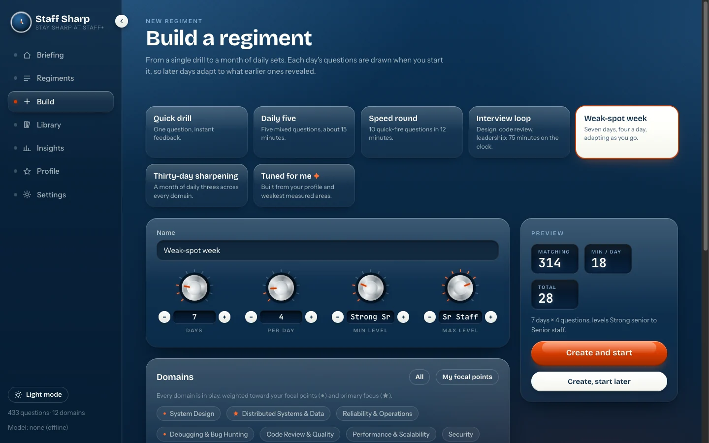

### Timed sets and the chronograph

Timed sets put a moonwatch-style chronograph in the corner. The central hand beats six times a second, and the time budget
shows as an arc on the 30-minute register. Either pusher starts or stops it. While it's stopped, the server withholds the
question text, so there is nothing on the page to read. Leaving the tab mid-set is counted in the report.

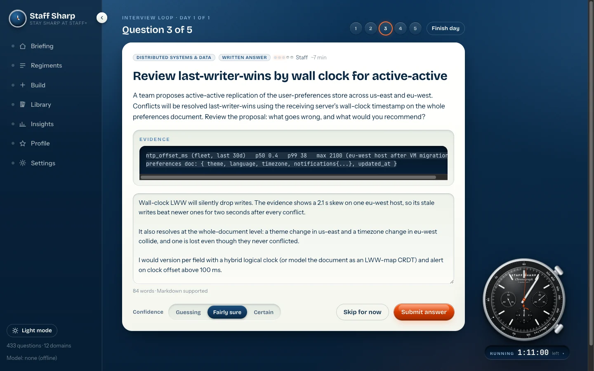

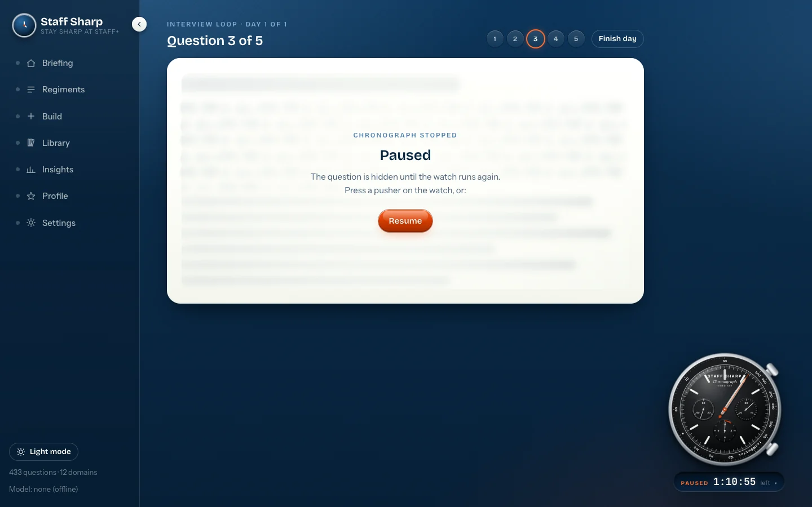

### Eight question types

| Type | How it's graded |
| --- | --- |
| Multiple choice, select all that apply | Exactly; partial credit on select-all |
| Estimation | Credit by ratio to the answer: full within a tolerance, falling to zero |
| Put in order | Rank correlation. Reorder by drag and drop, arrow buttons or the keyboard |
| Bug hunt, code review | Click lines to comment. Comments are matched to issue lines, weighted by severity, and the model grades your explanations. Each question has TypeScript, Go, Rust, C# and Java versions, shown in your primary language |
| Written answer | The model grades against a rubric of key points and red flags. Offline: a keyword pass, then you grade yourself |
| Diagram | Box-and-arrow editor. Required components are checked automatically; the model grades the design |

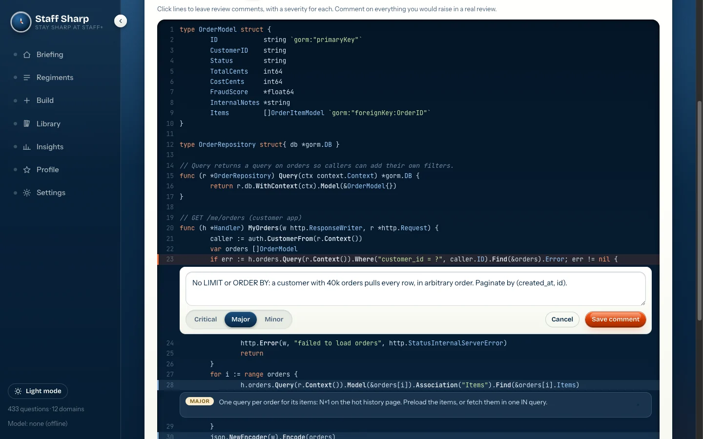

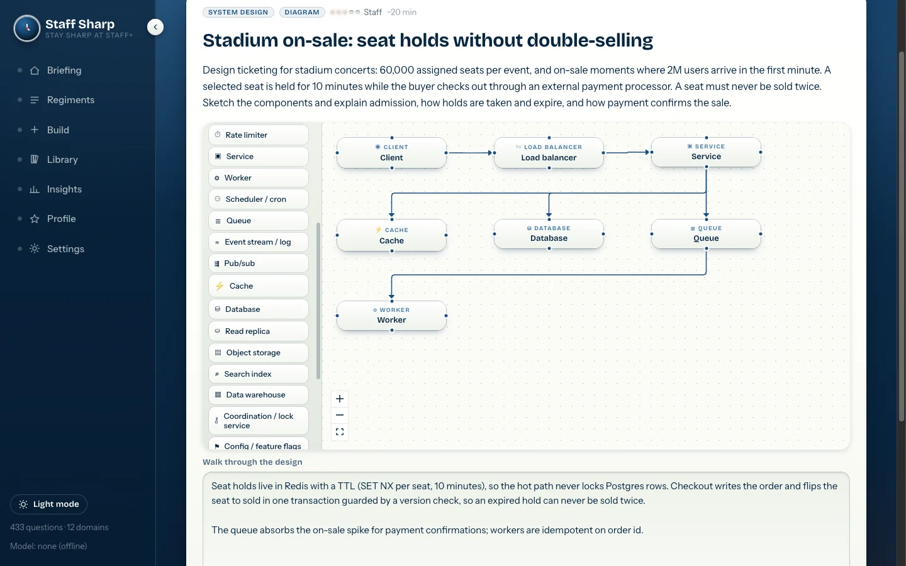

### Feedback

Every answer gets two scores. **Accuracy** is how right it was. **Potential** rates the reasoning and how well your
confidence matched reality: a hedged miss scores higher than a confident one, and an answer you were certain about but got
wrong is flagged as a blind spot. After a code review, the real issues are highlighted next to your comments.

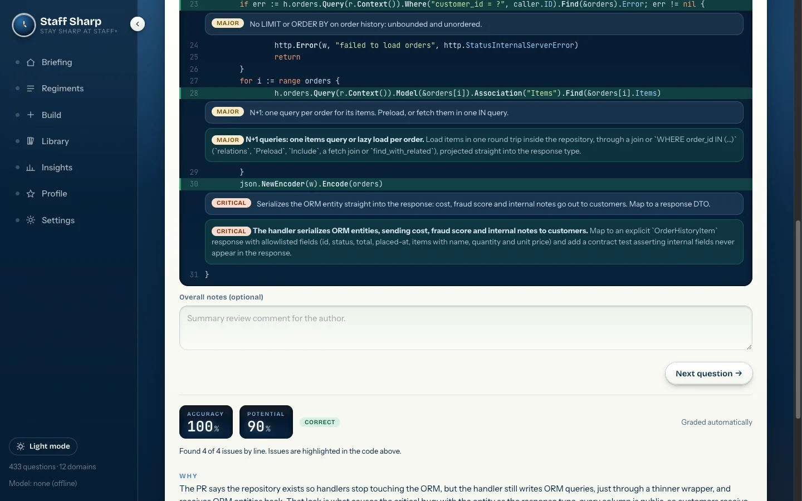

### Regiment report

Each regiment ends with a report: grade, a breakdown by domain, skill, question type and day, blind spots, and weakest
concepts. It also gives a direction: a rules-based one always, rewritten by the AI coach when a model is configured, plus a
one-click follow-up regiment.

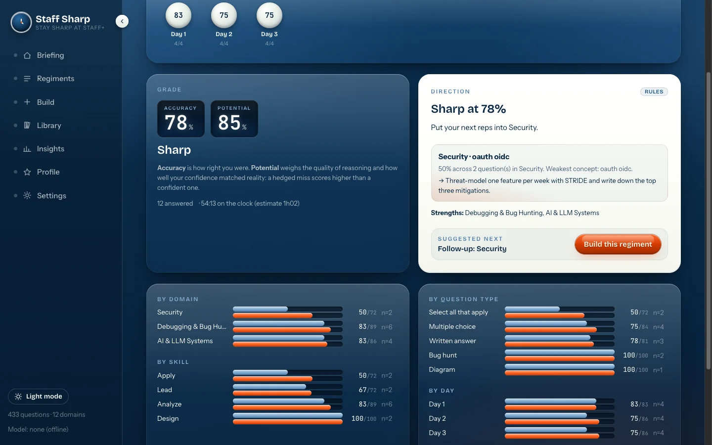

### Insights

Built from the ledger of every answer you've given:

- Weekly accuracy and potential, answers per week, and each domain's mastery trajectory with its 30-day change.
- Biggest movers, and recurring misses you can drill in one click.
- Coach history: a timeline of profile summaries and regiment debriefs.
- A filterable ledger linking back to each day's review.

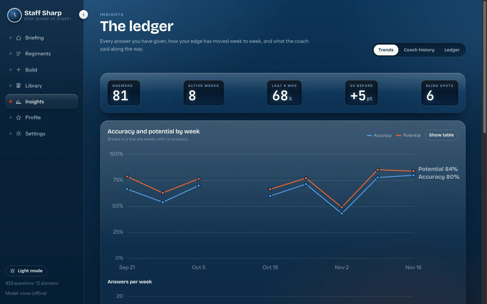

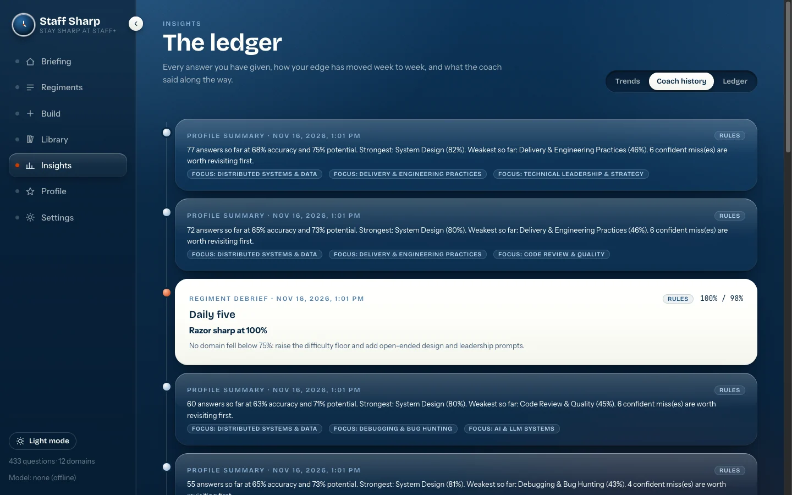

### Profile

A star plot of mastery and potential by domain, with your focal points (●) and primary focus (★) marked. Mastery is
difficulty-weighted with a 45-day half-life, so it reflects how sharp you are now. The page also shows calibration, blind
spots, your streak, and a summary of where to focus next.

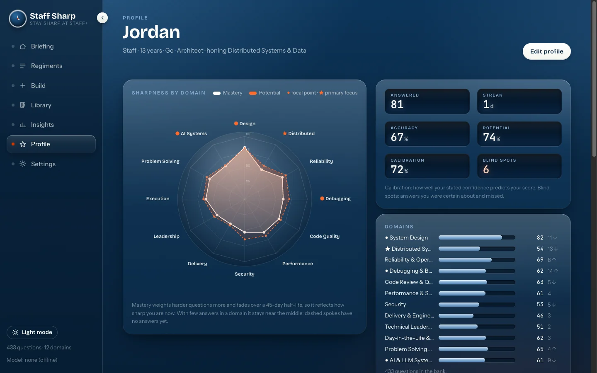

### Library

Browse the bank by domain, type, level or search. Prompts and answers stay hidden until you drill a question.

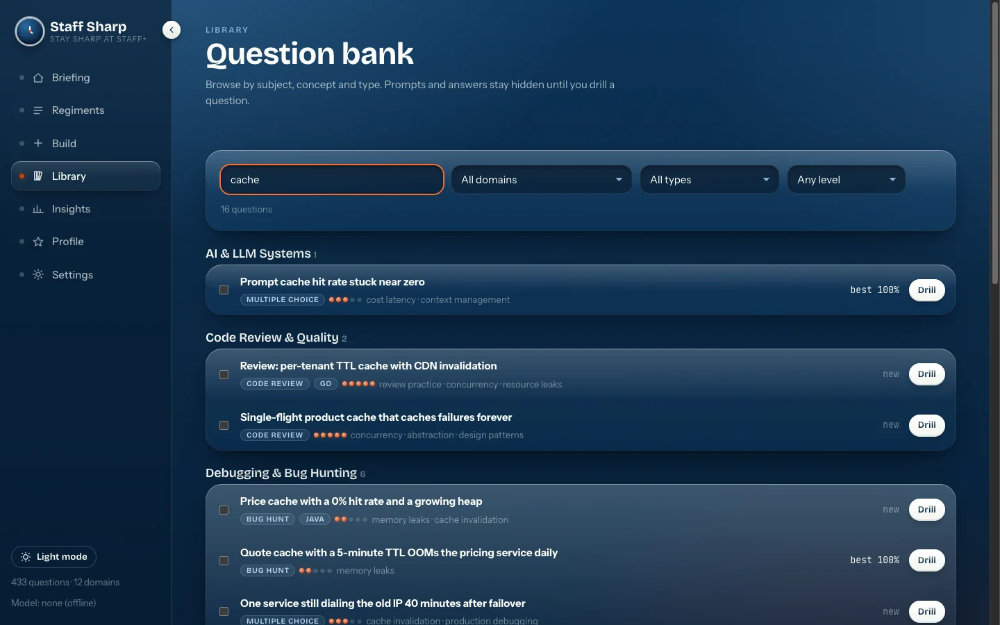

### Light mode, code themes and phones

Light, dark or follow the system, with an animated circular reveal when you switch. There are 12 code color schemes: Staff
Sharp, GitHub Light and Dark, One Dark, Dracula, Monokai, Solarized Light and Dark, Nord, Tokyo Night, Catppuccin Mocha and
Shades of Purple. Every page was checked at phone, tablet, laptop, desktop, 2K and 4K sizes. On phones the watch folds into
a small pill with a pause button.

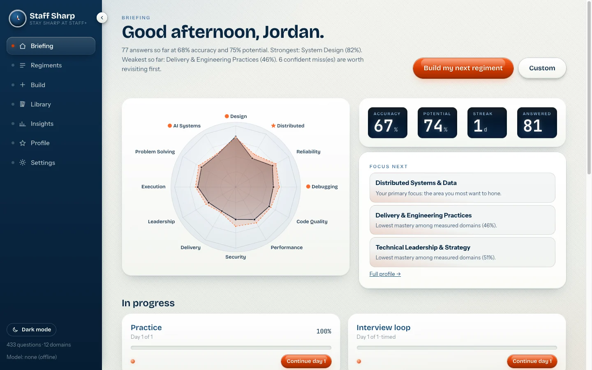

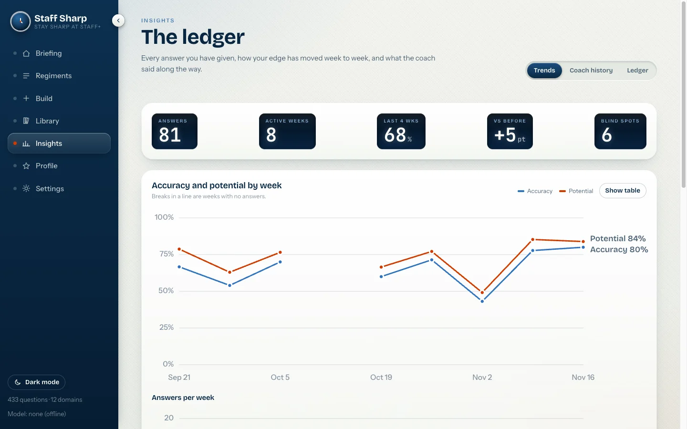

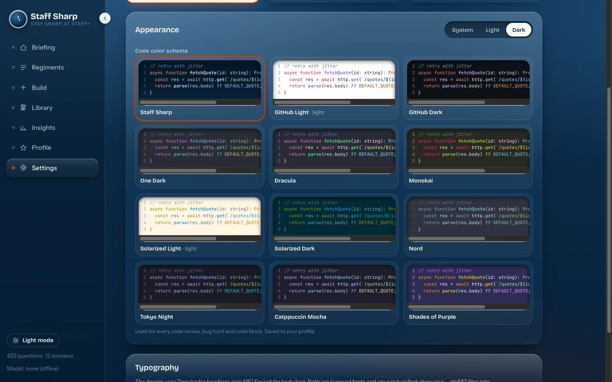

<p>
  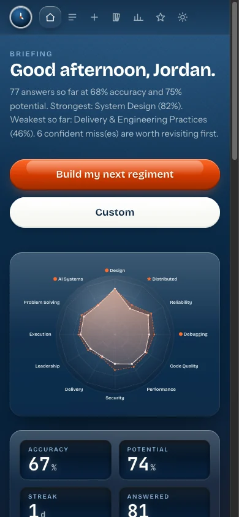
  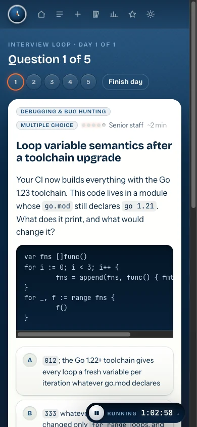
</p>

## Model providers (Settings)

| Provider | How |
| --- | --- |
| None | Everything works: closed question types grade exactly, and you grade written answers yourself against the rubric |
| Claude Code subscription | The `claude-runner` service runs the same agents on your subscription through the Claude Agent SDK. Link it from Settings, which runs `claude auth login` in the container; the login is kept in the `claude_home` volume |
| Anthropic API key | The Flue agent service (`agent`) calls the API. The key is stored AES-256-GCM encrypted (keyed by `APP_SECRET`) or read from `ANTHROPIC_API_KEY` |

There are four agents, each returning structured output: the **grader**, the **scenario writer** (fresh questions tailored to
your stack), the **coach** (regiment debriefs) and the **profile summary**. Their prompts and schemas live in one place,
`agent/src/prompts/`, and both providers share them.

## Architecture

| Service | What |
| --- | --- |
| `web` | React 19 + Vite, served by nginx, which proxies `/api` |
| `api` | Go (`net/http`, pgx). Owns all data, seeds the question bank on every start, picks questions, does the deterministic grading and the reports, and runs the background queue for model work |
| `agent` | Flue 2.3 on Node: the four agents on an API key |
| `claude-runner` | The same agents on a Claude Code subscription |
| `db` | Postgres 17 |

## Fonts

The design calls for **Degular** (headings) and **ABC Favorit** (body). Both are licensed, so they aren't in the repo. Put
the `.woff2` files in `web/public/fonts/` (that folder's README lists the file names) and rebuild `web`. Until then the app
uses Bricolage Grotesque and Instrument Sans.

## Development

```bash
node scripts/validate-questions.mjs                 # after editing the bank
(cd api && go build ./... && go vet ./... && go test ./...)
(cd agent && npm run typecheck)
(cd web && npm run build)
npm --prefix web run dev                             # Vite on :5173, proxying /api to the running stack on :8484
```

To add questions, see [docs/QUESTION_SCHEMA.md](docs/QUESTION_SCHEMA.md).

To refresh the screenshots, run a separate copy of the stack with demo data, so your own history is never touched:

```bash
ANTHROPIC_API_KEY= WEB_PORT=8585 docker compose -p sharp-docs up -d --build
```

Then seed it with `python3 scripts/seed-demo.py`, capture each page at 1440×900 (390×844 for phones) and save the images as
WebP in `docs/screenshots/`. Remove the copy afterwards:

```bash
docker compose -p sharp-docs down -v
```
